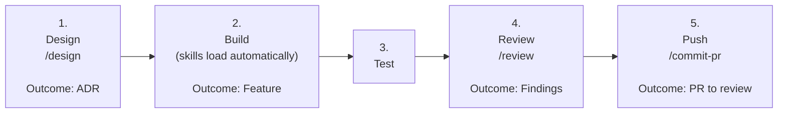

# Contributing to Gothic Unity
We love your input! We want to make contributing to this project as easy and transparent as possible, whether it's:

For gamers:
- Discussing the current state of the code
- Reporting a bug
- Proposing new features

For developers:
- Submitting a fix
- Becoming a maintainer

## For gamers

Simple as that: Download the game and join our [Discord Server](https://discord.gg/nvnaWwEu5Y) to get in touch
with the developers and the Gothic community.

## For developers

To all coders and VR developers: Welcome, you're at the right spot.

We're mainly building Gothic by leveraging C# classes and building core Unity magic.
(Nearly no 2D/3D designs are needed as we load _everything_ from original assets at runtime).

The project opens and builds without any paid assets. No headset at hand? Turn on `EnableVRDeviceSimulator` in the
DeveloperConfig to play the VR version with mouse and keyboard.

If you want to build Gothic together, then you're encouraged to join our active developer base. Feel free to grab a ticket you'd like to drive and reach out to us on our [Discord](https://discord.gg/nvnaWwEu5Y) Server for further questions.

### We Develop with GitHub
> You'll find our current feature development status at the [Projects](https://github.com/Gothic-Unity-Project/Gothic-Unity/projects?query=is%3Aopen) page.

We use GitHub to host code, to track issues and feature requests, as well as accept pull requests.

### All Code Changes Happen Through Pull Requests
Pull requests are the best way to propose changes to the codebase. We welcome your pull requests:

1. Try to align with current status of the project and team member's work (Discord).
2. Fork the repo and create your branch from `main`.
3. Issue your pull request with extensive information about what changed and how to test it.

### Report bugs using GitHub's [issues](https://github.com/Gothic-Unity-Project/Gothic-Unity/issues)
We use GitHub issues to track public bugs. Report a bug by [opening a new issue](https://github.com/Gothic-Unity-Project/Gothic-Unity/issues/new); it's that easy!

### Write bug reports with detail, background, and sample code
**Great Bug Reports** tend to have:

- A quick summary and/or background
- Steps to reproduce
    - Be specific!
    - Give sample code if you can.
- What you expected would happen
- What actually happens
- Notes (possibly including why you think this might be happening, or stuff you tried that didn't work)

(People *love* thorough bug reports. I'm not even kidding.)

### Use a Consistent Coding Style
To assist consistent development styles, we:
1. set up an .editorconfig file which is automatically used by Rider and VS22+
2. wrote an exhaustive example at our docs: [Coding Style Guide](https://github.com/Gothic-Unity-Project/Gothic-Unity/wiki/Coding-Style-Guide)

### Be Open About AI Usage

We use AI agents ourselves (see [AI_USE.md](AI_USE.md)), so we're fine with AI-assisted contributions.
We just want to know about them.

In your pull request, tell us how much AI helped.
Because ultimately: You own your your pull request. Therefore review your code and test your submissions.

### Working with Claude Code

Our Claude Code setup lives in [.claude/](.claude/README.md). Agents you call by name, e.g. "use
architecture-reviewer on my plan". Skills load on their own when the task fits.

1. **Design:** `/design` asks you the open decisions, writes the plan, drafts the decision record
   `Docs/adr/<date>-<topic>.md` and has the `architecture-reviewer` agent check the plan. You approve the ADR.
   > /design VR ledge climbing for #123
2. **Build:** skills such as `daedalus-bridge` and `feature-checklist` load automatically.
   > Implement the plan.
3. **Test:** the `playtest-planner` agent writes the in-game test steps, you play them.
   > What should I test?
4. **Review:** `/review` runs the `gothic-reviewer` (bugs, style) and `architecture-reviewer` (structure)
   agents and stores their reports locally. For each open finding you decide: fix it, follow-up, or disagree.
   > Do a review
5. **Push:** `/commit-pr` commits and opens or updates the PR with a summary of the latest review and posts the full
   reports as a comment. If the review is missing or outdated, it runs it first. Without the `gh` CLI it prepares
   the texts for you to paste. A human reviews the PR.
   > /commit-pr open the PR  
   > /commit-pr update the PR

### License
By contributing, you agree that your contributions will be licensed under its GPL-3.0 License.
